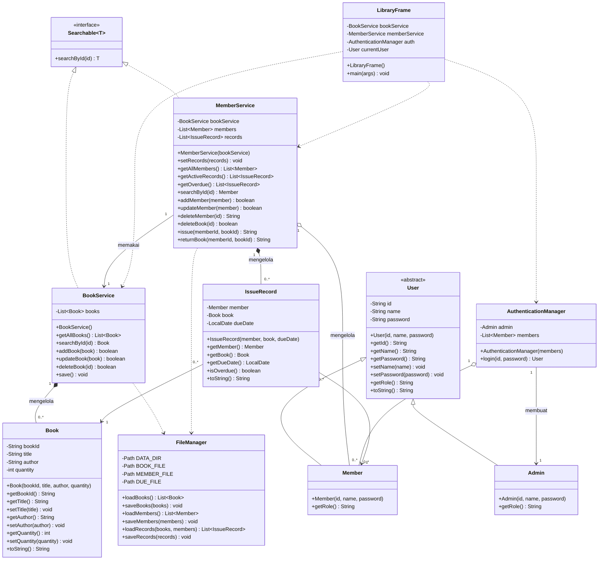

# Diagram Class — Manajemen Perpustakaan

Diagram di bawah mengikuti kode di `src/perpus/` (10 class + 1 interface).
GitHub merender blok Mermaid ini otomatis.

## Arti panah

| Simbol | Arti | Contoh di proyek |
|---|---|---|
| `──▷` garis penuh, segitiga kosong | inheritance | `Admin`, `Member` → `User` |
| `┄┄▷` garis putus, segitiga kosong | realization (interface) | `BookService`, `MemberService` → `Searchable` |
| `──◆` belah ketupat penuh | composition | `BookService` ◆ `Book`, `MemberService` ◆ `IssueRecord` |
| `──◇` belah ketupat kosong | aggregation | `MemberService` ◇ `Member` |
| `──▶` panah penuh | association | `IssueRecord` → `Book`, `IssueRecord` → `Member` |
| `┄┄▶` panah putus | dependency | service → `FileManager`, `LibraryFrame` → service |
| `1` / `0..*` | multiplicity | `MemberService` 1 — `0..*` `Member` |

## Penerapan PBO

- **Abstraction** — `User` abstract, `getRole()` wajib diisi turunan.
- **Inheritance** — `Admin` dan `Member` mewarisi `User`.
- **Polymorphism** — `getRole()` dioverride; `LibraryFrame.currentUser` bertipe
  `User` tapi perilakunya beda. `Searchable<T>` dipakai lewat tipe interface.
- **Encapsulation** — semua field `private`, akses lewat getter/setter.
- **Composition / Aggregation / Dependency** — lihat tabel panah di atas.

## Lokasi file

| Class | File |
|---|---|
| `User` | `src/perpus/User.java` |
| `Admin` | `src/perpus/Admin.java` |
| `Member` | `src/perpus/Member.java` |
| `Book` | `src/perpus/Book.java` |
| `IssueRecord` | `src/perpus/IssueRecord.java` |
| `Searchable` | `src/perpus/Searchable.java` |
| `BookService` | `src/perpus/BookService.java` |
| `MemberService` | `src/perpus/MemberService.java` |
| `AuthenticationManager` | `src/perpus/AuthenticationManager.java` |
| `FileManager` | `src/perpus/FileManager.java` |
| `LibraryFrame` | `src/perpus/LibraryFrame.java` |
