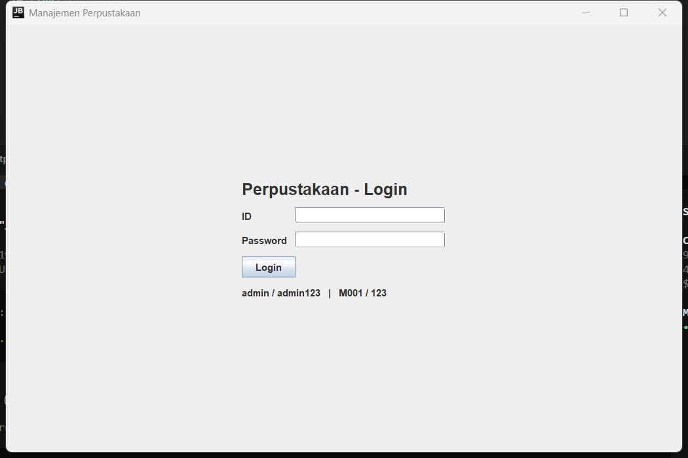
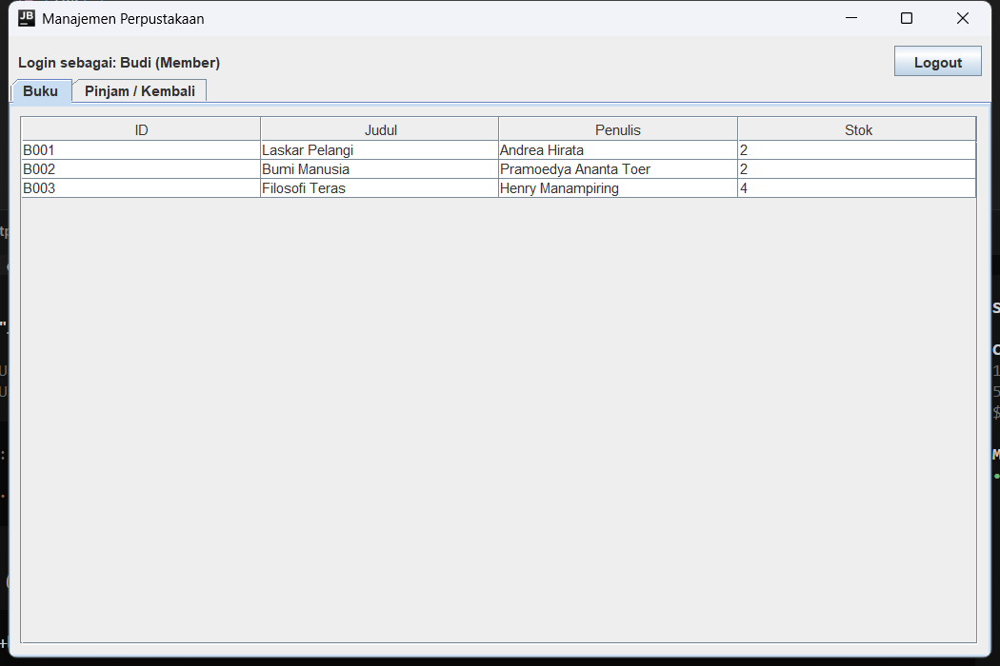
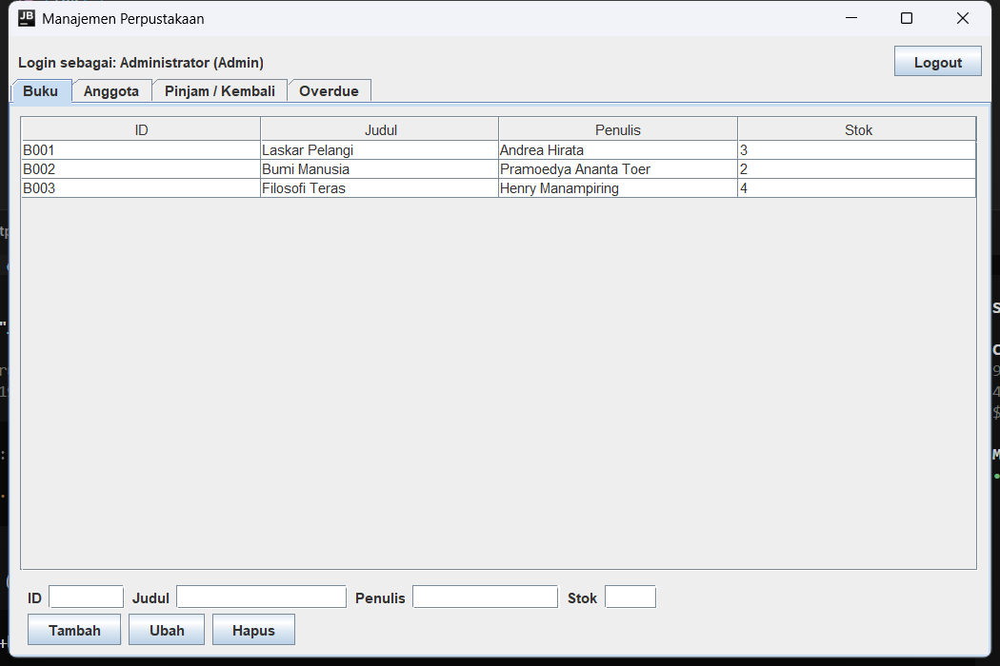
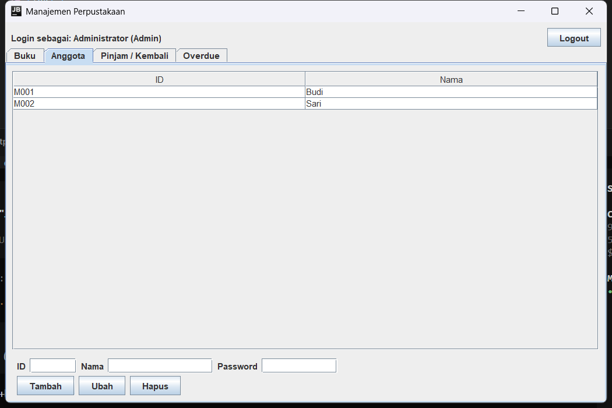
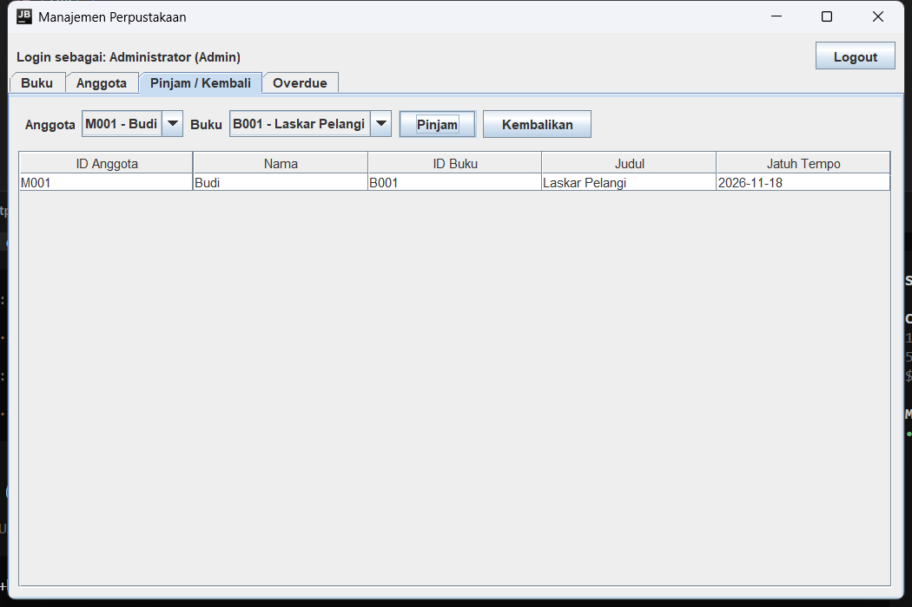
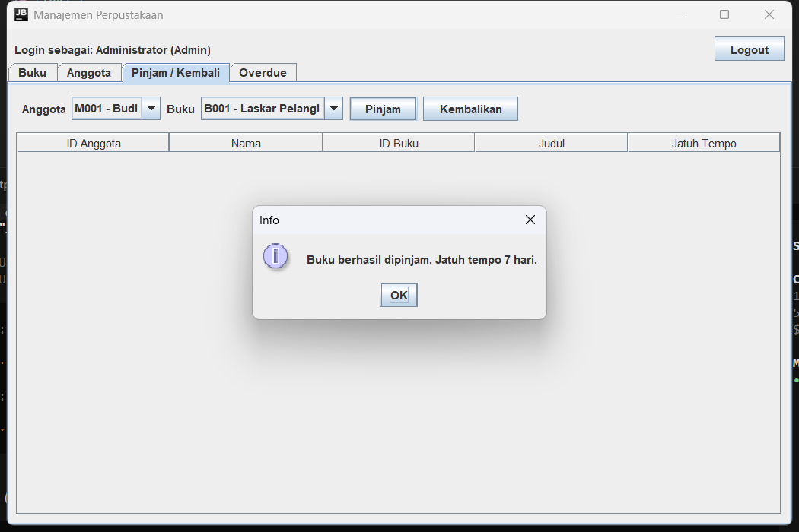
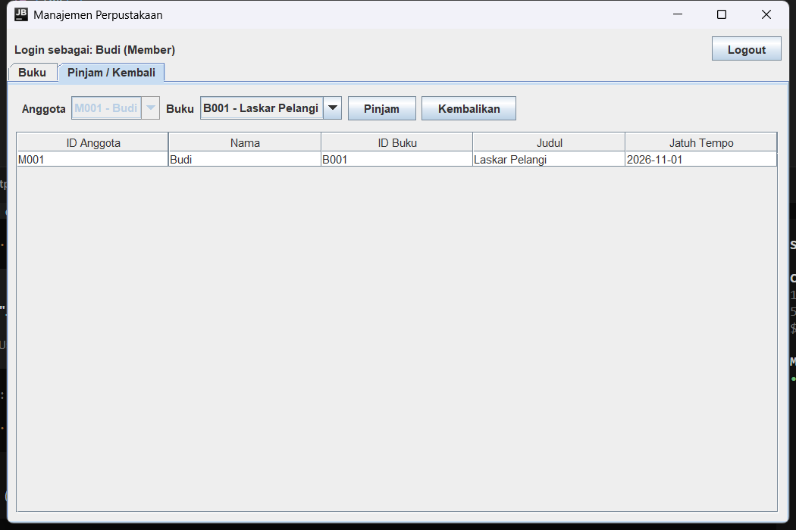
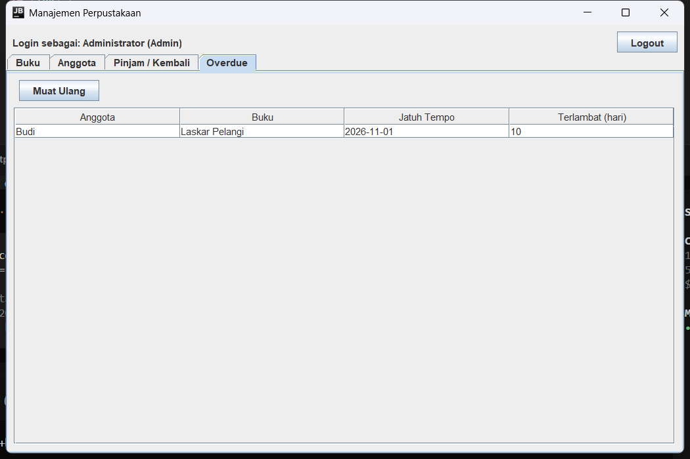

# Panduan Menggunakan Aplikasi Perpustakaan

## 1. Sebelum menjalankan

Butuh **JDK 17 atau lebih baru**. Cek dulu:

```
java -version
```

Kalau muncul `'java' is not recognized`, pakai path lengkap JDK (contoh di bagian 2).

## 2. Compile dan jalankan

Dari folder proyek:

```
javac -d out src/perpus/*.java
java -cp out perpus.LibraryFrame
```

Kalau `javac` tidak dikenali:

```
& "C:\Program Files\Android\Android Studio\jbr\bin\javac.exe" -d out src\perpus\*.java
& "C:\Program Files\Android\Android Studio\jbr\bin\java.exe" -cp out perpus.LibraryFrame
```

Jendela **Perpustakaan - Login** akan muncul. Folder `data/` dibuat otomatis
saat pertama dijalankan.



## 3. Akun untuk demo

| ID | Password | Bisa apa saja |
|---|---|---|
| `admin` | `admin123` | Semua tab: Buku, Anggota, Pinjam/Kembali, Overdue |
| `M001` | `123` | Buku (lihat saja) + Pinjam/Kembali |
| `M002` | `123` | Sama seperti M001 |

Akun ini juga tertulis sebagai petunjuk kecil di bawah tombol Login.

**Cara login:** isi ID, isi Password, klik **Login** (atau tekan Enter di kolom
password). Salah password → muncul "ID atau password salah."

## 4. Isi layar setelah login

Bagian atas: `Login sebagai: Administrator (Admin)` dan tombol **Logout**.

Menu tengah berupa tab, dan isinya berbeda menurut peran:

| Tab | Admin | Anggota |
|---|---|---|
| Buku | lihat + tambah/ubah/hapus | lihat saja |
| Anggota | ada | tidak ada |
| Pinjam / Kembali | ada, pilih anggota mana pun | ada, anggota terkunci ke dirinya sendiri |
| Overdue | ada | tidak ada |

Tampilan akun anggota — hanya dua tab, dan tab Buku tanpa form:



## 5. Tab Buku (admin)

Kolom: **ID, Judul, Penulis, Stok**. Stok = jumlah yang **tersedia**, bukan total.



**Tambah buku**

1. Isi ID (misal `B004`), Judul, Penulis, Stok (angka).
2. Klik **Tambah**.
3. ID dan Judul wajib. Stok harus angka dan tidak boleh negatif.
4. ID yang sudah dipakai → "ID buku sudah dipakai."

**Ubah buku**

1. Klik satu baris di tabel → form terisi otomatis.
2. Ubah Judul / Penulis / Stok.
3. Klik **Ubah**.

ID tidak bisa diganti lewat tombol Ubah. Kalau ID diubah, muncul
"Buku tidak ditemukan." Kalau perlu ganti ID, hapus lalu tambah baru.

**Hapus buku**

1. Klik satu baris.
2. Klik **Hapus**.

Buku yang sedang dipinjam tidak bisa dihapus ("Buku sedang dipinjam atau tidak
ditemukan."). Kembalikan dulu bukunya.

## 6. Tab Anggota (admin)

Kolom: **ID, Nama**. Password tidak ditampilkan di tabel, tapi muncul di form
saat baris dipilih.



**Tambah anggota**

1. Isi ID (misal `M003`), Nama, Password.
2. Klik **Tambah**. Ketiganya wajib.

**Ubah anggota** — pilih baris, ubah Nama/Password, klik **Ubah**. ID tidak
bisa diganti.

**Hapus anggota** — pilih baris, klik **Hapus**. Anggota yang masih punya
pinjaman aktif ditolak dengan pesan "Anggota masih punya pinjaman aktif."

## 7. Tab Pinjam / Kembali



**Meminjam**

1. Pilih anggota di combo **Anggota** (untuk akun anggota, combo ini terkunci
   ke dirinya sendiri).
2. Pilih buku di combo **Buku**.
3. Klik **Pinjam**.
4. Muncul "Buku berhasil dipinjam. Jatuh tempo 7 hari." Stok buku berkurang 1.



Yang ditolak:

- Stok 0 → "Stok buku habis."
- Anggota yang sama meminjam buku yang sama dua kali → "Anggota ini masih
  meminjam buku tersebut."

**Mengembalikan**

1. Klik baris pinjaman di tabel (kolom: ID Anggota, Nama, ID Buku, Judul,
   Jatuh Tempo).
2. Klik **Kembalikan**. Stok bertambah 1, baris hilang dari tabel.

Untuk akun anggota: hanya bisa mengembalikan baris miliknya sendiri.



## 8. Tab Overdue (admin)

Menampilkan pinjaman yang sudah lewat tanggal jatuh tempo: Anggota, Buku,
Jatuh Tempo, **Terlambat (hari)**.



Tab ini tidak memperbarui diri sendiri. Klik **Muat Ulang** setelah mengubah
data atau membiarkan aplikasi terbuka lama.

Kalau daftar kosong, artinya belum ada yang terlambat — bukan error.

## 9. Cara mendemokan overdue

1. Login `admin`, tab **Pinjam / Kembali**, pinjam satu buku.
2. **Tutup aplikasi** (klik X).
3. Buka `data/dueDates.txt` dengan Notepad. Isinya: `M001;B001;2026-11-18`.
4. Ubah tanggalnya jadi masa lalu, misal `2026-11-01`. Simpan.
5. Jalankan lagi aplikasinya, login, buka tab **Overdue**.
6. Buku itu muncul dengan kolom "Terlambat (hari)".

Kenapa harus tutup aplikasi dulu: aplikasi menyimpan seluruh data setiap kali
ada perubahan. Kalau file diedit saat aplikasi masih terbuka, perubahan itu
akan ditimpa saat tombol apa pun diklik.

## 10. Logout dan ganti akun

Klik **Logout** di kanan atas → kembali ke layar login. Login sebagai akun lain
untuk menunjukkan perbedaan hak akses (tab Anggota dan Overdue hilang untuk
anggota).

## 11. Data tersimpan di mana

```
data/bookRecords.txt    B001;Laskar Pelangi;Andrea Hirata;3
data/memberRecords.txt  M001;Budi;123
data/dueDates.txt       M001;B001;2026-11-18
```

- Pemisah `;`. Jangan pakai `;` di judul/nama.
- Data awal otomatis dibuat kalau folder `data/` kosong: 3 buku + 2 anggota.
- **Reset ke data awal:** tutup aplikasi, hapus folder `data/`, jalankan lagi.
- Format baris: `id;judul;penulis;stok` — jangan menambah/mengurangi titik koma.

## 12. Masalah yang sering muncul

| Gejala | Penyebab | Solusi |
|---|---|---|
| `'javac' is not recognized` | JDK tidak di PATH | Pakai path lengkap seperti di bagian 2 |
| Jendela tidak muncul | Compile gagal | Lihat pesan `javac`, perbaiki dulu |
| "ID atau password salah" | Salah ketik / huruf besar | ID tidak peka huruf besar, password peka |
| "Stok buku habis" | Stok 0 | Ubah stok di tab Buku, atau kembalikan buku |
| Buku tidak bisa dihapus | Masih dipinjam | Kembalikan dulu |
| Overdue kosong | Belum lewat jatuh tempo | Ikuti bagian 9 |
| Muncul dialog "Terjadi kesalahan" | File data terkunci / tidak bisa ditulis | Tutup aplikasi lain yang membuka file itu, cek izin folder |
| Data kembali ke awal | Folder `data/` terhapus atau dijalankan dari folder lain | Jalankan dari folder proyek yang sama |
| Dialog data tidak valid | Baris file rusak atau input berisi `;` | Perbaiki baris sesuai format atau hapus `;` dari input |

## 13. Urutan demo 5 menit

1. **Login admin** — tunjukkan 4 tab.
2. **Tambah buku** `B004` "Clean Code", stok 2 → muncul di tabel.
3. **Tambah anggota** `M003` "Rina" / `123`.
4. **Pinjam** Rina + Clean Code → stok jadi 1, baris muncul di tabel pinjaman.
5. **Coba pinjam lagi** buku yang sama untuk Rina → ditolak (aturan pinjam ganda).
6. **Coba hapus** buku Clean Code → ditolak (sedang dipinjam).
7. **Kembalikan** → stok kembali 2.
8. **Overdue** — ikuti bagian 9 kalau sudah disiapkan sebelumnya.
9. **Logout, login `M001`** — tunjukkan tab Anggota dan Overdue hilang, combo
   anggota terkunci.
10. Tutup dengan membuka `docs/diagram-class.md` di GitHub.

## 14. Kalau dosen bertanya "mana penerapan PBO-nya"

| Konsep | Tunjukkan di mana |
|---|---|
| Abstraction | `User` abstract, `getRole()` tanpa isi |
| Inheritance | `Admin extends User`, `Member extends User` |
| Polymorphism | `User currentUser` di `LibraryFrame`, `getRole()` hasilnya beda; `Searchable<T>` |
| Encapsulation | semua field `private` di `User`, `Book`, `IssueRecord` |
| Composition | `BookService` memegang `List<Book>`; `MemberService` memegang `List<IssueRecord>` |
| Aggregation | `MemberService` memegang `List<Member>` yang bisa berdiri sendiri |
| Interface | `Searchable<T>` diimplementasikan `BookService` dan `MemberService` |
